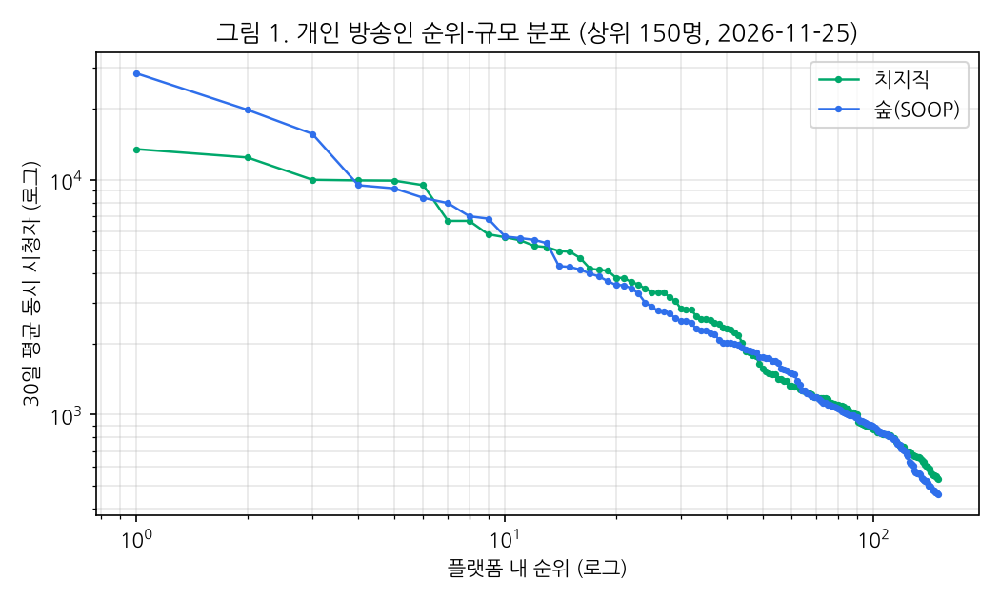
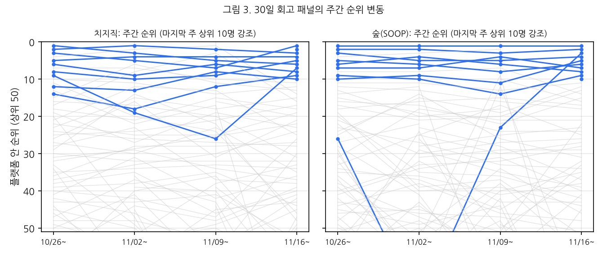
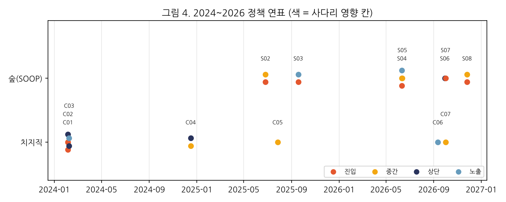
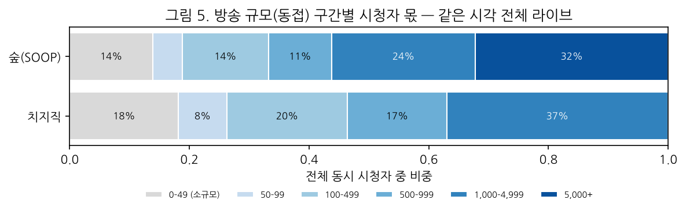
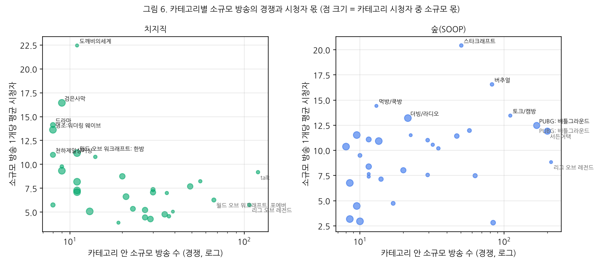

# 중계권 집중과 스타 집중: 치지직과 숲의 시청 구조, 추천 노출, 정책 사다리 비교

**초고 (학회 발표용, 진행 중 연구)** · 데이터 기준일 {{s1_date}} · 모든 수치는 `analysis/` 코드로 다시 계산한 값

> 요약 — 2023년 트위치 철수 이후 국내 라이브 스트리밍은 치지직(네이버)과 숲(SOOP)의 양강 구도가 됐다. "치지직은 대형 쪽으로 굳어 간다"는 주장과 "숲은 아직 경쟁 우위가 있다"는 주장이 함께 돌지만, 실증 검토는 드물다. 이 연구는 집중을 '얼마나'가 아니라 '무엇에' 몰렸는가로 나눠, 공식·중계 채널에 몰리는 **중계권 집중**과 소수 개인 방송인에 몰리는 **스타 집중**을 구분한다. 다섯 개의 하위 연구(명단 횡단 분석, 순위 이동성 패널, 비로그인 추천 감사, 정책 코딩, 실시간 전수 스냅샷)로 가설 여섯 개를 검토했다. 개인 방송인 상위 100명 안에서 상위 10명의 시청 비중은 치지직 {{s1_chzzk_top10_100}}, 숲 {{s1_soop_top10_100}}였다. 차이의 95% 구간({{s1_ci_top10_100}})은 0을 포함했고, 방향은 오히려 숲 쪽이 더 집중된 쪽이었다. 같은 시각 플랫폼 전체 라이브를 잰 전수 스냅샷에서, 동접 50명 미만의 소규모 방송은 방송 수의 {{s5_small_live_chzzk}}(치지직)·{{s5_small_live_soop}}(숲)를 차지했지만 시청자 몫은 {{s5_small_viewer_chzzk}}·{{s5_small_viewer_soop}}에 그쳤다. 2024~2026년 정책 {{s4_n_policies}}건을 코딩한 결과, 치지직의 제작 지원은 파트너 → 프로 → 챌린저로 아래쪽으로 넓어졌고, 홈에는 신입·소규모 방송인 슬롯이 두 개 있었다. "치지직이 사다리를 끊는다"는 주장과 맞지 않는 결과다. 다만 금전 지원의 맨 아랫칸은 비어 있다. 30일 회고 패널에서 상위 50명의 주간 순위 상관은 치지직 {{s2a_rho_chzzk}}, 숲 {{s2a_rho_soop}}로 치지직 상위권이 더 안정적인 방향이었지만 차이의 구간({{s2a_rho_ci}})은 0을 포함했다. 반면 방송인 한 명의 방송일별 시청자 변동은 숲이 더 컸다(변동계수 중앙값 차이 {{s2a_cv_ci}}). 추천 노출 감사(시범)에서는 두 플랫폼 모두 홈이 소규모 방송을 실제 비중보다 덜 보여 줬다. 이 연구는 추천 노출(H5)과 고착(H6)의 확증 분석 계획을 미리 고정해 두고, 8주 수집 뒤 판정한다.

**주제어**: 라이브 스트리밍, 플랫폼 집중, 중계권, 알고리즘 감사, 크리에이터 경제, 치지직, SOOP

---

## 1. 서론

### 1.1 문제 제기
2023년 12월 트위치의 한국 철수 이후 국내 라이브 스트리밍 시장은 네이버의 치지직과 숲의 경쟁으로 재편됐다. 2026년 들어 두 플랫폼의 위치가 바뀌는 신호가 겹쳤다. 스트림즈차트 집계로 2026년 3분기 총 시청시간은 치지직이 처음으로 숲을 앞섰다(격차 {{q3_gap}}만 시간). 같은 분기 숲의 플랫폼 매출은 전년보다 21.3% 줄었다. 반면 모바일인덱스의 2026년 8월 수치로 계산한 1인당 월 이용시간은 숲 {{per_user_soop}}시간, 치지직 {{per_user_chzzk}}시간으로, 숲 이용자가 {{per_user_ratio}}배 오래 머물렀다.

이런 변화를 두고 방송인 커뮤니티에서는 두 가지 주장이 함께 돈다. 하나는 숲이 이용자 체류라는 고유한 강점을 아직 지니고 있다는 주장이다. 다른 하나는 치지직이 스포츠 중계권과 대형 방송인 영입을 앞세워 성장한 만큼 시청이 큰 채널로 쏠리고, 작은 방송인이 올라갈 길이 막힌다는 주장이다. 두 주장 모두 실증 자료로 검토된 적은 드물다.

### 1.2 두 종류의 집중
"쏠린다"는 말에는 두 가지 뜻이 섞여 있다. 하나는 시청이 **공식·중계 채널**(뉴스, e스포츠·스포츠 중계)로 몰리는 것이고, 다른 하나는 **소수 개인 방송인**에게 몰리는 것이다. 앞의 것을 중계권 집중, 뒤의 것을 스타 집중이라 부르자. 둘은 플랫폼 전략에서 나오는 뿌리가 다르다. 중계권 집중은 포털 사업자가 콘텐츠 구매력으로 이용자를 끌어오는 방식(치지직의 올림픽·월드컵·LCK·뉴스 중계)에서, 스타 집중은 후원 수익을 나누는 크리에이터 중심 모델(숲의 별풍선, 크루 방송)에서 나온다. 작은 방송인에게 주는 의미도 다르다. 중계권 채널의 시청은 대형 이벤트를 따라 들고 나지만, 스타에게 몰린 시청은 누적 이점(Merton, 1968)을 거쳐 굳어질 수 있다. 이 연구는 두 집중을 따로 재고, 각각이 작은 방송인의 사다리와 어떻게 이어지는지 본다.

### 1.3 연구 질문과 가설
**용어.** 이 연구는 동시 시청자 50명 미만인 방송을 '소규모 방송', 주로 그런 규모로 방송하는 사람을 '소규모 방송인'이라 부른다. 커뮤니티에서 쓰는 비하 섞인 속칭 대신 규모를 나타내는 중립적인 말을 쓰기 위해서다. 50명은 등급 조건(치지직 챌린저 평균 동접 150명)보다 낮은, 첫 단계 성장 구간을 가리키는 기준이다.

연구 질문 넷(RQ1~RQ4)을 검증할 수 있는 가설 여섯 개로 바꿨다. 가설마다 주 지표와 판정 기준을 미리 정했고, 나머지 지표는 탐색 분석으로 표시한다.

| 가설 | 연구 질문 | 내용 | 주 지표 (연구) | 판정 기준 |
|---|---|---|---|---|
| H1 | RQ1 | 숲 이용자는 치지직 이용자보다 오래 머문다 | 1인당 월 이용시간 (시장 지표) | 숲 > 치지직 |
| H2 | RQ2-A | 치지직의 시청은 숲보다 공식·중계 채널에 더 몰린다 | 공식 채널의 시청자 몫 (연구 5, 보조: 소프트콘) | 치지직 > 숲, 반복 스냅샷에서 일관 |
| H3 | RQ2-A′ | 치지직의 개인 상위층은 숲보다 더 집중돼 있다 | 상위 100명 중 상위 10명 비중 (연구 1) | 차이(치지직−숲)의 95% 구간이 0보다 큼 |
| H4 | RQ2-C | 치지직 정책은 사다리 아랫칸에 혜택을 주지 않거나 줄여 왔다 | 사다리 칸별 정책 코딩 (연구 4) | 진입·중간 칸 정책이 없거나 줄어듦 |
| H5 | RQ3 | 치지직 홈은 숲보다 소규모 방송을 덜 노출한다 | 노출 비율의 플랫폼 차이 (연구 3) | 치지직 < 숲, 회차 부트스트랩 구간이 0 제외 |
| H6 | RQ4 | 치지직 상위권은 숲보다 더 굳어 있다 | 상위 50명 주간 순위 상관 (연구 2) | 치지직 > 숲, 구간이 0 제외 |

### 1.4 기여
첫째, 국내 두 플랫폼을 같은 시점, 같은 지표로 비교한 다중 방법 연구다. 둘째, 집중을 중계권 집중과 스타 집중으로 나눠 "어느 쪽이 더 집중됐나"라는 단일 축의 논쟁을 정리한다. 셋째, 같은 시각 전체 라이브를 기준선으로 쓰는 추천 노출 감사 설계를 제시하고, 감사 중에 드러난 플랫폼 쪽 제약(목록 상한, 기본 정렬, 등급 표시)을 문서로 남긴다. 넷째, 수집 윤리를 코드로 강제하고 원고 수치를 코드에서 채우는 재현 파이프라인을 공개한다.

## 2. 선행연구

### 2.1 플랫폼 집중과 슈퍼스타 경제
Rosen(1981)은 재능의 작은 차이가 보상의 큰 차이로 이어지는 '슈퍼스타 경제'를 설명했고, Frank와 Cook(1995)은 이를 승자독식 시장으로 일반화했다. 디지털 유통이 수요를 꼬리 쪽으로 퍼뜨린다는 롱테일 가설(Anderson, 2006)에 대해 Elberse(2008)는 오히려 머리 쪽 집중이 강해진다는 반론을 냈다. 누적 이점(Merton, 1968)과 선호적 연결(Barabási & Albert, 1999)은 초기의 작은 우위가 시간이 지나며 굳어지는 기제를 설명한다. 라이브 스트리밍에서도 Houssard 외(2023)는 트위치의 수익과 시청이 소수 채널에 강하게 몰려 있음을 보였다. 이 연구는 이 논의를 국내 두 플랫폼의 비교로 옮기되, 집중의 '수준'(연구 1)과 '굳어짐'(연구 2)을 나눠 본다.

### 2.2 알고리즘 감사
Sandvig 외(2014)는 외부 연구자가 플랫폼의 비공개 알고리즘을 관찰 가능한 입력과 출력으로 점검하는 '알고리즘 감사'의 유형을 정리했다. Hannák 외(2013)는 계정 조건을 통제한 대조 수집으로 검색 개인화를 측정했고, Ribeiro 외(2020)는 유튜브 추천 경로를 대규모로 추적했다. Bandy(2021)는 이런 감사 연구가 차별, 왜곡, 착취, 판단 오류의 네 범주를 다룬다고 정리했다. 이 연구의 연구 3은 개인화를 배제한 비로그인 조건에서 홈 추천과 같은 시각의 전체 라이브 분포를 비교하는 '기준선 대비 노출' 설계를 쓴다.

### 2.3 크리에이터 경제와 플랫폼 정책
Nieborg와 Poell(2018), Poell 외(2021)는 문화 생산이 플랫폼의 규칙과 보상 구조에 맞춰 재편되는 '플랫폼화'를 논의했다. Bucher(2012)는 알고리즘이 정하는 가시성이 창작자에게 '보이지 않게 될 위협'으로 작동한다고 보았다. Taylor(2018)와 Johnson과 Woodcock(2019)은 트위치 방송인의 노동과 수익화가 플랫폼의 등급·후원 제도에 묶여 있음을 보였다. 이 연구의 연구 4는 등급, 수익 분배, 지원 사업, 노출 장치가 방송인 경력의 어느 칸(진입·중간·상단·노출)에 혜택을 주는지 코딩해, 정책이 사다리를 '끊는지'를 직접 묻는다.

## 3. 연구 방법

### 3.1 자료와 수집 윤리
모든 수집은 공개 페이지에서 비로그인으로 했다. robots.txt를 지켰고, 페이지 로드 사이 10초 이상, 같은 사이트 요청 사이 30초 이상을 두었다. 429나 차단 화면이 나오면 기록하고 멈췄다. IP 순환, CAPTCHA 우회, 봇 탐지 회피, 가짜 계정은 쓰지 않았다. 서명이 필요한 비공개 API를 흉내 내지 않고, 페이지가 스스로 받은 응답만 읽었다. 개인정보는 수집하지 않았다(채널명과 공개 수치만).

이 규칙 때문에 쓰지 못한 자료가 있다. 소프트콘(softc.one)은 봇 확인 화면(HTTP 429)을 띄워 직접 수집을 중단했고, 소프트콘 수치는 언론 인용으로만 쓴다. 위플뷰(weflview.com)의 과거 랭킹은 robots.txt가 금지한 `/api/` 경로로만 불러와져 쓰지 않았다.

### 3.2 연구 1: 시청 집중도 횡단 분석 (RQ2-A′)
stream-rate.com의 뷰어십 순위({{s1_date}} 기준 {{s1_n_total}}명)를 파싱했다. 필드는 순위, 이름, 플랫폼(치지직·숲·동시 송출), 카테고리, 최근 30일 평균 동시 시청자, 하루 방송시간, 팔로워다. 스포츠 채널 {{s1_n_sports}}명과 동시 송출 {{s1_n_simulcast}}명을 빼면 치지직 {{s1_n_chzzk}}명, 숲 {{s1_n_soop}}명이 남는다. 플랫폼별 상위 50·100·150명에서 상위 10명 비중, 상위 3명 비중, 지니계수, 동접 500·1,000·5,000명 이상 인원을 구했다. 플랫폼 간 차이(숲 − 치지직)의 95% 구간은 플랫폼별 명단 안에서 복원 추출하는 부트스트랩(5,000회)으로 구했다. 강건성 검증으로 플랫폼별 1위 제외, 동시 송출 포함(양쪽에 모두 넣음), 게임 카테고리만의 세 시나리오를 돌렸다. 상위 k명 비중과 지니계수는 명단을 어디까지 넣었는지에 따라 달라지므로, 상위 n명 안의 순위-규모 기울기 α(log 동접 = c − α·log 순위)를 함께 보고했다. α가 클수록 위쪽이 가파르다.

### 3.3 연구 2: 순위 이동성 (RQ4, H6)
**2a. 30일 회고 패널.** stream-rate의 개인 기록 페이지에는 최근 30일 방송일별 평균·최고 동접이 있다. 기준일 명단에서 플랫폼별 상위 100명(스포츠·동시 송출 제외)의 기록을 받아({{s2a_days}}), 방송일 평균 동접을 월~일 주 단위로 묶었다(방송일 2일 미만인 주는 제외). 주마다 플랫폼 안 순위를 매기고, 연속한 주 사이 상위 20명 교체율, 상위 50명 순위의 스피어만 상관, 평균 순위 변화, 방송인별 방송일 동접 변동계수를 구했다. 플랫폼 차이의 구간은 방송인을 단위로 한 부트스트랩이다. 표본이 기준일의 상위권이라 30일 사이 떨어져 나간 사람이 빠진다(생존자 편향). 그래서 교체율은 낮게 나오지만, 두 플랫폼에 같은 방식으로 걸리므로 비교에는 쓸 수 있다.

**2b. 8주 전향 패널.** 연구 1의 수집을 하루 1회 돌려 SQLite에 날짜별 스냅샷으로 쌓는다(최소 8주). 같은 지표에 더해, 직전 스냅샷 명단에 없던 신규 진입자가 상위 50명에 든 수를 구한다. stream-rate 수치는 30일 이동평균이라 7일 간격 비교는 23일이 겹친다. 결론은 겹치지 않는 30일 간격 비교를 우선한다.

### 3.4 연구 3: 추천 노출 감사 (RQ3)
Playwright(Chromium)로 데스크톱 조건(1920×1080, ko-KR, Asia/Seoul)을 맞추고, 회차마다 쿠키가 빈 새 브라우저 컨텍스트를 연다. 한 회차에 두 플랫폼 홈을 5분 안에 연달아 수집한다(스크롤 사이 30초, 첫 화면 + 스크롤 3번). 보이는 카드마다 섹션, 섹션 안 순서, 채널, 채널 ID, 동접, 카테고리, 공식 채널 여부를 기록하고 HTML과 스크린샷을 보관한다. 치지직 카드의 수치는 페이지가 받은 홈 응답에서 채널 ID로 찾고, 숲은 카드 DOM에서 읽는다. 선택자는 `config/selectors.yaml`에 두었다.

기준선은 같은 시각 '전체 라이브'의 소규모 방송 비율이다. 치지직 전체 방송 페이지의 기본 정렬은 '추천순'(100개)이라 기준선이 될 수 없어 '시청자순'으로 바꿔 수집했다. 시청자순 목록을 끝까지 내리면 회차당 수십 분이 걸리고, 치지직 웹은 시청자순 목록을 120개(20개 × 6페이지)까지만 불러왔다(다음 페이지 커서가 있어도 더 요청하지 않음, 2026-11-25 관찰). 그래서 50명 경계(동접 50명 미만)가 나올 때까지만 내려 50명 이상 방송 수를 정확히 세고(치지직은 120번째 방송이 49명 이하일 때만 완전한 셈으로 인정), 전체 라이브 수로 나눠 소규모 방송 비율을 구한다(기준선 소규모 방송 비율 = 1 − 50명 이상 방송 수 ÷ 전체 라이브 수). 전체 라이브 수는 숲은 목록 응답의 전체 수(`totalCount`), 치지직은 카테고리 페이지가 받는 카테고리별 방송 수의 합이다. 치지직 값은 카테고리 없는 방송이 빠지는 하한이므로 소규모 방송 비율이 낮게, 노출 비율이 높게 잡힌다. 따라서 치지직 노출 비율이 1보다 작게 나오면 실제 과소 노출은 그보다 크다.

노출 비율 = (추천 카드 중 소규모 방송 비율) ÷ (전체 라이브 중 소규모 방송 비율). 계획은 7일 × 하루 4개 시간대(12·18·22·02시) × 시간대당 약 4회, 플랫폼당 약 100회이며, 회차를 단위로 한 부트스트랩 구간과 대형 이벤트 더미(`config/events.yaml` + 공식 채널 2만 명 이상 자동 판정)를 붙인다.

### 3.5 연구 4: 정책 내용 분석 (RQ2-C, RQ1)
2024~2026년 두 플랫폼의 등급, 수익 분배, 지원 사업, 노출 정책을 보도자료와 기사에서 모았다. 정책마다 혜택 대상(치지직: 루키·프로·챌린저·파트너, 숲: 일반·베스트·파트너)과 사다리 영향(진입·중간·상단·노출)을 코딩했다. 출처는 최초 보도일을 한국시간으로 적고, 같은 날 다른 매체의 보도는 재보도로 구분했다. 날짜를 확인할 수 없으면 "날짜 확인 불가"로 적었다({{s4_undated}}).

### 3.6 연구 5: 실시간 전수 스냅샷 (RQ2-A·A′, H2 보강)
연구 1의 명단은 섭외용 상위권이라 플랫폼 전체를 대표하지 않는다. 그래서 같은 시각 플랫폼 전체 라이브를 모집단으로 다시 쟀다. 숲은 시청자순 '전체 라이브' 목록을 끝까지 받아 모든 방송의 동접을 얻었다. 치지직은 웹 목록이 120개까지만 나오므로, 동접 50명 이상 방송은 목록에서(120번째가 49명 이하일 때 완전), 전체 방송 수와 전체 시청자 수는 카테고리 페이지의 카테고리별 방송 수·시청자 합에서 얻었다. 지표는 상위 10개 방송과 상위 1% 방송의 시청자 몫, 소규모 방송의 비율과 그 시청자 몫, 공식 채널(치지직 `officialChannel`, 숲은 이름 규칙)의 시청자 몫이다. 저녁·밤처럼 치지직의 50명 이상 방송이 120개를 넘는 시각에는 소규모 방송 관련 지표를 비워 두고 상위권 몫만 보고한다.

## 4. 결과

### 4.1 시장 지표 (RQ1 배경)
{{table_market}}

1인당 이용시간은 보도된 총 이용시간을 MAU로 나눠 다시 계산한 값으로, 숲 {{per_user_soop}}시간, 치지직 {{per_user_chzzk}}시간이다(선행 결과 16.8시간·9.2시간과 같음). 치지직 MAU는 6월 월드컵(533만 명)과 9월 아시안게임(450만 명) 때 크게 오르내려, 월별 비교는 기준 달에 민감하다.

### 4.2 연구 1: 개인 방송인 집중도
{{table_s1_main}}

상위 100명 기준으로 상위 10명 비중은 치지직 {{s1_chzzk_top10_100}}, 숲 {{s1_soop_top10_100}}로 숲이 {{s1_diff_top10_100}} 높았지만, 95% 구간({{s1_ci_top10_100}})이 0을 포함했다. 지니계수(치지직 {{s1_chzzk_gini_100}}, 숲 {{s1_soop_gini_100}}, 차이 구간 {{s1_ci_gini_100}})도 같은 결론이다. 상위 3명 비중은 숲 {{s1_soop_top3_100}}, 치지직 {{s1_chzzk_top3_100}}이었고 구간({{s1_ci_top3_100}})은 0을 겨우 포함했다. 그림 1에서 보이듯 숲은 1~3위가 다른 방송인보다 크게 높고, 치지직은 상위권이 더 평평하다. 동접 1,000명·5,000명 이상 인원 수는 두 플랫폼이 비슷했다.

**강건성.**
{{table_s1_robust}}

**순위-규모 기울기.** 명단 범위에 덜 민감한 α로 봐도 결론은 같다(상위 100명 α: 치지직 {{s1_zipf_chzzk_100}}, 숲 {{s1_zipf_soop_100}}, 차이 구간 {{s1_zipf_ci_100}}).

{{table_s1_zipf}}

1위를 빼면 차이가 줄었다(상위 100명 상위 10명 비중 차이 {{s1_drop1_diff_top10_100}}, 구간 {{s1_drop1_ci_top10_100}}). 숲의 집중이 1위 한 명에 크게 기대고 있다는 뜻이다. 게임 카테고리만 보면 숲 쪽 집중이 더 뚜렷해(상위 10명 비중 치지직 {{s1_games_chzzk_top10_100}}, 숲 {{s1_games_soop_top10_100}}), 상위 3명 비중 차이의 구간({{s1_games_ci_top3_100}})은 0을 벗어났다. 다만 시나리오 4개 × 표본 3개 × 지표 3개를 함께 본 결과이므로 이 한 칸을 독립된 유의 결과로 읽지 않는다.

**선행 결과와 비교.**
{{table_prior_vs_now}}

명단이 하루 사이 늘었지만(새 방송인 편입) 결론은 같다. 치지직이 숲보다 대형 개인 방송인에 더 쏠려 있다는 증거는 없고, 방향은 오히려 반대다.

### 4.3 연구 2: 순위 이동성
**2a. 30일 회고 패널 (시범).** 치지직 {{s2a_n_chzzk}}명, 숲 {{s2a_n_soop}}명의 방송일별 기록으로 주간 순위를 매겼다.

{{table_s2a}}

연속한 주 사이 상위 20명 교체율은 평균 치지직 {{s2a_turn_chzzk}}, 숲 {{s2a_turn_soop}}였고, 상위 50명 순위 상관은 치지직 {{s2a_rho_chzzk}}, 숲 {{s2a_rho_soop}}로 나타났다(차이 숲−치지직 {{s2a_rho_ci}}). 첫 주와 마지막 주를 비교한 상위 20명 교체율은 치지직 {{s2a_fl_chzzk}}, 숲 {{s2a_fl_soop}}였다. 방송인 한 명의 방송일 동접 변동계수 중앙값은 숲이 더 컸다(치지직 {{s2a_cv_chzzk}}, 숲 {{s2a_cv_soop}})(차이 {{s2a_cv_ci}}). 정리하면 치지직 상위권은 주 단위 순위가 더 안정적인 방향이었으나 통계적으로 불확실했고, 숲 방송인은 날마다 시청자가 더 크게 출렁였다(구간이 0을 벗어남). 숲의 큰 변동은 합방·크루 이벤트처럼 날마다 규모가 달라지는 콘텐츠의 비중과 맞물릴 수 있지만, 이 자료로 원인을 가리지는 않는다. 한 달 창과 생존자 편향 때문에 이 결과는 H6의 시범 근거로만 쓴다.

**2b. 8주 전향 패널.** {{s2_status}}. 첫 스냅샷은 {{s2_first}}이다.

{{table_s2}}

### 4.4 연구 3: 추천 노출 감사 (시범)
현재 상태: {{s3_status}}.

{{table_s3}}

섹션별 카드 구성:

{{table_s3_sections}}

치지직 홈 응답에는 채널의 인증 등급(`verifiedMarkType`: PARTNER·CHALLENGER)이 함께 실려 와, 추천 카드가 어느 등급에 돌아가는지 볼 수 있다. 인증 마크가 없는 채널은 루키 또는 프로다(응답만으로는 둘을 나눌 수 없다). 기준선 목록은 50명 경계까지만 받은 시청자순 목록이라 대부분 동접 50명 이상 채널이다.

{{table_s3_tiers}}

시범 회차의 노출 비율은 치지직 {{s3_ratio_chzzk}}, 숲 {{s3_ratio_soop}}이다(상단 히어로 제외). 치지직 홈 카드의 {{s3_rec_share_chzzk}}가 소규모 방송이었지만 같은 시각 전체 라이브의 소규모 방송 비율은 {{s3_base_share_chzzk}}(50명 이상 {{s3_big_chzzk}}개 ÷ 전체 {{s3_total_chzzk}}개로 계산)였다. 숲은 각각 {{s3_rec_share_soop}}, {{s3_base_share_soop}}(50명 이상 {{s3_big_soop}}개 ÷ 전체 {{s3_total_soop}}개)였다. 두 플랫폼 모두 1보다 작다. 이는 홈이 시청자가 많은 방송을 앞세운다는 점에서 예상 가능한 결과이며, 이 연구의 질문은 "치지직이 숲보다 소규모 방송을 덜 보여 주는가"이다. 시범 회차에서는 오히려 치지직의 노출 비율이 높았는데, 치지직 홈의 소규모 방송 카드 대부분이 '신입 스트리머 인사드립니다!'와 '🎊팔로워 50명 돌파🎊' 두 슬롯에서 나왔다(섹션 표). 다만 회차가 하나이고 시간대도 낮 12시 하나라 이 값으로 RQ3를 판정하지 않는다.

시범 회차에서 확인한 질적 사실 세 가지는 판정과 무관하게 기록해 둔다. 첫째, 치지직 홈에는 첫 방송일이 최근인 채널을 보여 주는 '신입 스트리머 인사드립니다!' 슬롯(`LIVE_NEW_STREAMER`)과 팔로워 50명을 막 넘긴 채널을 보여 주는 슬롯이 있었고, 실린 채널은 모두 동접 한 자릿수였다. 둘째, 치지직 홈의 '이 방송 어때요?' 슬롯은 응답 메타데이터에 추천 시스템(`RCMD`) 출처로 표시된다. 즉 홈의 일부는 인기순이 아니라 추천 로직이 고른다. 셋째, 치지직 추천 카드에서 파트너 비율({{s3_partner_rec}})이 기준선 목록의 파트너 비율({{s3_partner_base}})보다 높았다. 추천이 등급에 따라 기울어지는지는 본 수집에서 검정할 가설로 남긴다.

### 4.5 연구 4: 정책 연표와 사다리 코딩
{{table_s4_timeline}}

사다리 칸별 정책 수:

{{table_s4_matrix}}

치지직은 정책이 {{s4_n_chzzk}}건, 숲은 {{s4_n_soop}}건이다. 치지직 제작 지원의 대상은 2024년 2월 파트너 한정(회당 최대 2천만 원)에서 2025년 8월 프로(최근 30일 30시간 방송, 회당 최대 100만 원), 2026년 11월 챌린저(직전 3개월 평균 동접 150명 이상, 연 최대 3천만 원)로 아래쪽으로 넓어졌다. 숲은 같은 기간 베스트 등급 문턱을 낮추고(방송 500 → 100시간, 3개월 방송일 60 → 30일), 루키존(누적 방송 1,000시간 미만), 웰컴 버추얼, 파트너스 멘토링 같은 진입 단계 장치를 늘렸다. 숲은 진입 칸 정책이 더 많고, 치지직은 중간 칸(프로·챌린저)을 새로 채우는 데 집중했다.

**선행 결과의 수정 두 가지.** (1) 선행 결과는 "루키 진입 문턱이 낮다(팔로워 150명, 1년 총시청자 500명, 20시간)"고 적었지만, 이 조건은 루키가 아니라 루키에서 프로로 올라가는 조건이다(루키는 조건 없이 방송 가능). (2) 선행 결과는 "소규모 방송 전용 노출 장치는 숲에만 확인됐다"고 적었지만, 치지직 홈에도 신입 방송인 노출 슬롯이 있음을 이번 감사에서 직접 확인했다(도입일은 확인 불가).

### 4.6 연구 5: 실시간 전수 스냅샷
{{table_s5}}

같은 시각 전체 라이브로 보면, 소규모 방송은 방송 수의 대부분(치지직 {{s5_small_live_chzzk}}, 숲 {{s5_small_live_soop}})을 차지하지만 시청자 몫은 치지직 {{s5_small_viewer_chzzk}}, 숲 {{s5_small_viewer_soop}}에 그쳤다. 상위 10개 방송의 시청자 몫은 치지직 {{s5_top10_chzzk}}, 숲 {{s5_top10_soop}}였다. 공식 채널의 시청자 몫은 치지직 {{s5_official_chzzk}}, 숲 {{s5_official_soop}}였는데, 스냅샷 시각에 뉴스·중계가 없으면 0에 가깝다. H2의 판정에는 중계가 몰리는 저녁 시각을 포함한 반복 스냅샷이 필요하다(스냅샷 수: 치지직 {{s5_n_chzzk}}, 숲 {{s5_n_soop}}).

### 4.7 가설별 판정
| 가설 | 선행 판정(11-24) | 이번 판정 | 근거 |
|---|---|---|---|
| H1 숲의 체류 우위 (RQ1) | 부분적으로 맞음 | **지지(2차 자료)** | 1인당 {{per_user_soop}} vs {{per_user_chzzk}}시간. 다만 RQ1 전체(경쟁 우위)는 "부분적으로 맞음": 총 시청시간 역전, 매출 −21.3%, 스타 의존(상위 3명 비중 {{s1_soop_top3_100}}) |
| H2 공식·중계 채널 쏠림 (2-A) | 맞음 | **잠정 지지(2차 자료), 1차 검증 진행 중** | 소프트콘 2026년 2월: 상위 10개 채널 중 공식·중계 몫 치지직 36.7%, 숲 4.82%. 전수 스냅샷 {{s5_n_chzzk}}회는 판정에 부족 |
| H3 개인 상위층 집중 (2-A′) | 근거 없음 | **기각** | 상위 10명 비중 치지직 {{s1_chzzk_top10_100}} vs 숲 {{s1_soop_top10_100}}, 구간 {{s1_ci_top10_100}}. 기울기 α도 차이 없음. 방향은 숲이 더 집중 |
| H4 사다리 아랫칸 배제 (2-C) | 절반만 맞음 | **기각(부분 수정)** | 지원 대상이 파트너 → 프로 → 챌린저로 아래로 확대. 신입 노출 슬롯 2개. 다만 금전 지원의 맨 아랫칸(루키)은 비어 있음 |
| H5 소규모 방송 과소 노출 (RQ3) | 미검증 | **미검증(시범)** | 시범 노출 비율 치지직 {{s3_ratio_chzzk}}, 숲 {{s3_ratio_soop}}. 둘 다 1 미만, 치지직이 낮지 않음 |
| H6 상위권 고착 (RQ4) | — | **미검증(시범, 방향 일치)** | 30일 회고 패널 순위 상관 치지직 {{s2a_rho_chzzk}} > 숲 {{s2a_rho_soop}}, 차이 구간 {{s2a_rho_ci}}로 0 포함. 일별 변동은 숲이 큼. 8주 전향 패널로 확증 |

## 5. 논의

**치지직: 중계권 집중 + 고르게 퍼졌지만 안정적인 개인 상위층.** 치지직이 "대형 쪽으로 굳는다"는 말은 중계권 채널에 대해서만 맞을 가능성이 크다(H2 잠정 지지). 개인 방송인 상위층은 숲보다 평평했고(H3 기각), 주 단위 순위는 더 안정적인 방향이었다(H6 시범, 불확실). 중계권 채널의 시청은 대형 이벤트를 따라 크게 출렁인다(MAU 533만 → 371만 → 450만 명). 그래서 이 집중이 개인 방송인의 기회를 구조적으로 막는지는 이벤트를 통제한 추천 감사(H5)와 순위 이동성(H6)으로 따로 확인해야 한다.

**숲: 스타 집중과 체류의 강점.** 숲은 1~3위의 비중이 크고, 1위를 빼면 두 플랫폼의 차이가 크게 줄었다. 숲 방송인은 날마다 시청자가 더 크게 출렁였다. 숲이 3분기 매출 감소의 이유로 "대형 크루 방송 활동 감소와 일부 방송인 이탈"을 든 것과 맞물린다. 체류시간이라는 강점(H1)은 분명하다. 하지만 그 강점이 소수 스타에게 기대고 있다면, 이들이 떠날 때 플랫폼이 지는 위험도 크다. 중계권 집중이 '이벤트 위험'이라면, 스타 집중은 '이탈 위험'이다.

**소규모 방송의 자리.** 전수 스냅샷에서 소규모 방송은 두 플랫폼 모두 방송 수의 대부분을 차지하지만 시청자 몫은 작다. 이는 두 플랫폼에 공통된 롱테일 구조다. 따라서 "치지직이 작은 방송인을 밀어낸다"는 주장을 검증하려면 수준이 아니라 **차이**를 봐야 한다. 같은 시각 기준선 대비 홈 노출(H5), 그리고 아래에서 위로 올라가는 이동(H6, 2b의 신규 진입)이다.

**사다리의 빈칸.** 정책 연표는 치지직이 사다리를 끊었다기보다, 위에서 아래로 칸을 채워 내려왔음을 보여 준다(H4 기각). 남은 빈칸은 금전 지원의 맨 아랫칸이다. 숲이 누적 10시간 방송만으로 콘텐츠지원센터를 열어 두고 루키존·멘토링으로 진입 단계를 두텁게 한 것과 비교하면, 치지직의 루키는 노출은 받아도 돈과 지도는 받지 못한다.

## 6. 실천적 함의: 소규모·신진 방송인을 위한 근거

이 장은 앞의 결과를 소규모·신진 방송인이 쓸 수 있는 정보로 옮긴다. 각 시사점은 근거가 된 결과와 확실성 수준을 함께 적는다. 여기서 말하는 것은 관찰된 경향이지 성공을 보장하는 처방이 아니다. 대부분 한두 시각의 스냅샷에서 나온 것이므로 시간대·요일·대형 이벤트에 따라 달라질 수 있다.

### 6.1 카테고리: 경쟁의 밀도와 작은 방송의 몫
같은 시각 전수 스냅샷에서 카테고리마다 소규모 방송이 몇 개 있고, 그 방송들이 시청자를 얼마나 나눠 받는지 계산했다(치지직 {{s5b_round_chzzk}}, 숲 {{s5b_round_soop}}). 소규모 방송이 {{s5b_n_threshold}}개 이상인 카테고리만 비교했다. 그 카테고리들에서 소규모 방송 1개당 평균 시청자의 중앙값은 치지직 {{s5b_median_chzzk}}명, 숲 {{s5b_median_soop}}명이었다.

**소규모 방송이 상대적으로 많은 시청자를 나눠 받은 카테고리**

{{table_s5b_top}}

**소규모 방송이 가장 많이 몰린 카테고리**

{{table_s5b_crowded}}

두 가지 경향이 보인다. 첫째, 방송 수가 가장 많은 대형 카테고리(리그 오브 레전드, 토크 등)는 소규모 방송이 가장 많이 몰리는 곳이다. 이런 곳에서는 카테고리 시청자 대부분이 소수의 큰 방송으로 가고, 작은 방송 하나가 받는 몫은 작다. 둘째, 카테고리 시청자 중 소규모 방송의 몫이 큰 곳(가장 큰 방송 1개의 몫이 작은 곳)은 시청자가 여러 방송에 고루 흩어지는 카테고리다. 새로 시작하는 방송인에게는 "인기 카테고리인가"보다 **"그 카테고리에서 작은 방송도 시청자를 나눠 받는가"**가 더 직접적인 정보다. 단, 이 표는 한 시각의 단면이고, 카테고리 선택은 방송인의 관심·역량과 맞아야 지속된다.

### 6.2 단계별로 쓸 수 있는 제도
연구 4의 정책 코딩에서 사다리의 진입·중간 칸에 해당하는 제도를 모았다. 조건은 각 보도 시점 기준이므로, 신청 전에 플랫폼 공지에서 현행 조건을 확인해야 한다.

{{table_ladder_tools}}

치지직은 홈의 신입·소규모 방송 슬롯으로 첫 노출을 주고, 금전 지원은 프로(최근 30일 30시간 방송)부터 시작한다. 숲은 누적 방송 10시간부터 콘텐츠지원센터를 열어 두고, 누적 1,000시간 미만 방송인을 루키존으로 지원한다. 즉 **노출은 치지직이, 초기 금전·지도 지원은 숲이 더 두텁다.** 버추얼 방송인은 숲의 웰컴 버추얼(데뷔·이적 대상 노출과 제작 지원금)도 검토할 수 있다.

### 6.3 성장 지표를 읽는 법
- **시청자 몫은 롱테일 구조다.** 두 플랫폼 모두 소규모 방송이 방송 수의 대부분을 차지하고 시청자 몫은 20% 안팎이다(연구 5). 처음 몇 달 동접이 낮은 것은 개인의 실패라기보다 시장 구조의 평균적인 모습이다.
- **상위권은 주 단위로 크게 바뀌지 않는다.** 30일 회고 패널에서 상위 50명의 주간 순위 상관은 치지직 {{s2a_rho_chzzk}}, 숲 {{s2a_rho_soop}}로 나타났다(연구 2a). 상위권 진입은 단기 이벤트보다 누적의 결과일 가능성이 크다. 다만 이 결과는 상위권 표본에서 나온 것이라 소규모 방송인의 성장 경로를 직접 보여 주지는 않는다.
- **하루 숫자보다 추세를 본다.** 상위권 방송인도 방송일마다 시청자가 크게 달라진다(변동계수 중앙값 치지직 {{s2a_cv_chzzk}}, 숲 {{s2a_cv_soop}}; 숲이 더 큼). 하루 동접으로 방송을 평가하기보다 주 단위 평균과 방송 시간을 함께 보는 편이 덜 흔들린다.
- **등급 조건은 '평균'과 '시간'을 함께 본다.** 치지직 챌린저는 3개월 평균 동접 150명 이상과 월 60시간 이상을 함께 요구한다. 꾸준한 방송 시간이 조건의 절반이다.

### 6.4 이 장의 한계
카테고리 표는 낮 시간대 스냅샷 한두 개에서 나왔다. 저녁·주말 스냅샷이 쌓이면 바뀔 수 있다. 소규모 방송 1개당 평균 시청자는 평균이므로, 한 방송이 실제로 받는 시청자는 이보다 훨씬 적을 수 있다(숲 자료로 계산한 중앙값은 평균보다 낮다). 제도 조건은 보도 시점 기준이며 바뀔 수 있다.

## 7. 한계
1. **표본 선택.** stream-rate 명단은 섭외용으로 추린 약 550명이라 소규모 구간(동접 50명 미만)이 거의 없다(치지직 {{s1_chzzk_under50}}명, 숲 {{s1_soop_under50}}명). 연구 1의 집중도는 '상위권 안의 집중'이며 플랫폼 전체의 불평등이 아니다. 명단에 넣는 기준이 플랫폼마다 다르면 비교가 치우칠 수 있다.
2. **부트스트랩의 해석.** 명단 자체를 모집단으로 보는 복원 추출이라 "명단 구성이 조금 달랐다면" 정도의 불확실성만 반영한다. 상위 k명 비중은 극단값에 민감해 부트스트랩 구간이 넓고 치우칠 수 있다. 여러 시나리오를 함께 봤으므로 다중 비교 문제도 있다.
3. **기간과 생존자 편향.** 연구 1은 하루 스냅샷(30일 평균)이다. 연구 2a는 기준일 상위권의 지난 30일이라 떨어져 나간 방송인이 빠지고, 교체율이 낮게 나온다. 연구 3·5는 시범 회차뿐이고, 스냅샷 시각이 낮에 몰려 있어 중계가 몰리는 저녁의 구조는 아직 반영하지 못했다.
4. **비공개 알고리즘.** 추천 로직은 공개되지 않는다. 비로그인 감사는 개인화가 없는 기본 노출만 본다. 로그인 이용자의 홈은 다를 수 있다.
5. **2차 자료.** 시장 지표와 일부 정책은 언론 보도를 거친 값이다. 소프트콘 원자료는 수집 차단으로 직접 확인하지 못했고, 일부 정책은 공식 공지 원문을 확인하지 못했다(코딩표의 `verification` 열).
7. **코딩 신뢰도.** 정책 코딩은 연구자 한 명이 했다. 투고 전에 두 번째 코더의 독립 코딩으로 일치도(Cohen's κ)를 보고해야 한다.
6. **기준선 근사.** 치지직 전체 라이브 수는 카테고리별 방송 수 합이라 하한이다. 노출 비율이 높게 잡히는 방향의 편향이다. 또 치지직 웹이 시청자순 목록을 120개까지만 불러오므로, 동접 50명 이상 방송이 120개를 넘는 시간대(저녁·밤)에는 50명 이상 방송 수를 다 셀 수 없다. 그런 회차는 소규모 방송 비율의 상한만 얻으므로 주 분석에서 빼고 따로 보고한다.

## 8. 결론
현재 자료로는 "치지직이 대형 개인 방송인 쪽으로 굳는다"는 주장을 지지할 수 없다(H3 기각). 치지직의 집중은 중계권 채널에서 오고(H2 잠정 지지), 개인 상위층은 오히려 숲보다 고르다. 정책도 지원 대상을 아래로 넓혀 왔다(H4 기각). 다만 금전 지원의 맨 아랫칸은 비어 있다. 숲은 체류라는 강점을 지녔지만(H1), 시청과 매출이 소수 스타에 기대는 구조적 위험을 안고 있다. 소규모 방송이 롱테일에 머무는 것은 두 플랫폼 공통이다. 치지직이 소규모 방송을 더 덜 보여 주는지(H5)와 상위권이 더 굳어 있는지(H6)는 부록 B의 분석 계획대로 8주 자료를 모은 뒤 판정한다.

## 참고문헌
※ 학회 제출 전 서지 정보를 원문으로 다시 확인할 것.

- Anderson, C. (2006). *The Long Tail: Why the Future of Business Is Selling Less of More*. Hyperion.
- Bandy, J. (2021). Problematic machine behavior: A systematic literature review of algorithm audits. *Proceedings of the ACM on Human-Computer Interaction, 5*(CSCW1).
- Barabási, A.-L., & Albert, R. (1999). Emergence of scaling in random networks. *Science, 286*(5439), 509–512.
- Bucher, T. (2012). Want to be on the top? Algorithmic power and the threat of invisibility on Facebook. *New Media & Society, 14*(7), 1164–1180.
- Elberse, A. (2008). Should you invest in the long tail? *Harvard Business Review, 86*(7/8), 88–96.
- Frank, R. H., & Cook, P. J. (1995). *The Winner-Take-All Society*. Free Press.
- Hannák, A., Sapieżyński, P., Kakhki, A. M., Krishnamurthy, B., Lazer, D., Mislove, A., & Wilson, C. (2013). Measuring personalization of web search. *Proceedings of WWW 2013*.
- Houssard, A., Pilati, F., Tartari, M., Sacco, P. L., & Gallotti, R. (2023). Monetization in online streaming platforms: An exploration of inequalities in Twitch.tv. *Scientific Reports, 13*.
- Johnson, M. R., & Woodcock, J. (2019). "And today's top donator is": How live streamers on Twitch.tv monetize and gamify their broadcasts. *Social Media + Society, 5*(4).
- Merton, R. K. (1968). The Matthew effect in science. *Science, 159*(3810), 56–63.
- Nieborg, D. B., & Poell, T. (2018). The platformization of cultural production. *New Media & Society, 20*(11), 4275–4292.
- Poell, T., Nieborg, D. B., & Duffy, B. E. (2021). *Platforms and Cultural Production*. Polity.
- Ribeiro, M. H., Ottoni, R., West, R., Almeida, V. A. F., & Meira, W. (2020). Auditing radicalization pathways on YouTube. *Proceedings of FAT\* 2020*.
- Rosen, S. (1981). The economics of superstars. *American Economic Review, 71*(5), 845–858.
- Sandvig, C., Hamilton, K., Karahalios, K., & Langbort, C. (2014). Auditing algorithms: Research methods for detecting discrimination on internet platforms. *Data and Discrimination: Converting Critical Concerns into Productive Inquiry* (ICA preconference).
- Taylor, T. L. (2018). *Watch Me Play: Twitch and the Rise of Game Live Streaming*. Princeton University Press.

**자료 출처(보도)**: 정책·시장 지표의 개별 기사와 최초 보도일은 `data/policy/policies.csv`, `data/policy/market_facts.csv`에 URL과 함께 적었다.

## 부록 A. 재현
코드와 데이터: `platform-study/` (README.md 참고). 연구 1의 원본 HTML은 `data/raw/streamrate/{{s1_date}}.html.gz`, 감사 원본은 `data/raw/audit/`에 있다.

## 부록 B. 미검증 가설의 사전 분석 계획
수집이 끝나기 전에 분석 방법을 고정해 둔다. 이 계획에서 벗어난 분석은 탐색으로 표시한다.

- **H5 (추천 노출).** 표본: 7일 × 12·18·22·02시 × 시간대당 4회, 플랫폼당 약 100회차. 기준선은 시간대 첫 회차에 수집하고, 같은 시간대의 다른 회차에 ±3시간 안에서 짝짓는다. 주 지표: 히어로 영역을 뺀 홈 카드의 노출 비율. 검정: 회차 리샘플링 부트스트랩(5,000회)으로 구한 플랫폼 차이(치지직 − 숲)의 95% 구간. 치지직 기준선이 120개 상한 때문에 50명 경계를 못 넘은 회차는 주 분석에서 빼고 따로 보고한다. 보조: 시간대별 노출 비율, 대형 이벤트 더미(`config/events.yaml`, 공식 채널 2만 명 이상 자동 판정)를 넣은 회귀, 신입 슬롯을 뺀 노출 비율.
- **H6 (고착).** 표본: 2026-11-25부터 8주 이상의 일별 스냅샷. 주 지표: 겹치지 않는 30일 간격 상위 50명 순위의 스피어만 상관. 검정: 방송인 리샘플링 부트스트랩으로 구한 플랫폼 차이의 95% 구간. 보조: 상위 20·50명 교체율, 신규 진입자의 상위 50명 진입 수, 30일 회고 패널(2a) 결과와의 비교.
- **H2 (중계권 집중, 1차 검증).** 표본: 연구 3 기준선 회차마다 얻는 전수 스냅샷. 주 지표: 공식 채널의 시청자 몫(시각 평균). 검정: 스냅샷 리샘플링 부트스트랩. 소프트콘 2026년 2월 수치와의 비교는 방향 일치 여부만 본다.

## 부록 C. 소규모·신진 방송인을 위한 한 장 요약
1. **같은 시각 방송의 90% 안팎이 동접 50명 미만이고, 이들이 받는 시청자는 전체의 20% 안팎이다.** 초기의 낮은 숫자는 두 플랫폼 공통의 구조다.
2. **카테고리는 "인기"보다 "작은 방송의 몫"으로 고른다.** 방송 수가 가장 많은 카테고리는 경쟁도 가장 많고, 시청자는 소수의 큰 방송에 몰린다(6.1의 표).
3. **치지직은 첫 노출, 숲은 첫 지원.** 치지직 홈에는 신입·팔로워 50명 돌파 슬롯이 있다. 숲은 누적 10시간부터 콘텐츠 지원, 1,000시간 미만은 루키존이 있다.
4. **등급 조건은 시간과 평균을 함께 본다.** 치지직 프로는 최근 30일 30시간, 챌린저는 3개월 평균 동접 150명과 월 60시간이다.
5. **조건은 바뀐다.** 이 요약의 수치는 2026년 11월 기준이다. 신청 전에 플랫폼 공지를 확인한다.
