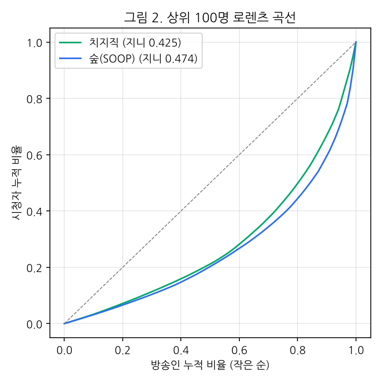

# 치지직과 숲의 플랫폼 성향과 고착화: 시청 집중, 추천 노출, 정책 사다리에 관한 실증 연구

**초고 (학회 발표용)** · 데이터 기준일 {{s1_date}} · 모든 수치는 `analysis/` 코드로 다시 계산한 값

> 요약 — 국내 라이브 스트리밍 시장은 2023년 트위치 철수 이후 치지직(네이버)과 숲(SOOP, 구 아프리카TV)의 양강 구도가 됐다. 이 연구는 "숲은 아직 경쟁 우위가 있는가", "치지직은 대형 쪽으로 굳어 가는가"라는 두 물음을 네 개의 하위 연구로 나눠 검토한다. (1) 개인 방송인 {{s1_n_total}}명의 30일 평균 동시 시청자로 본 집중도에서, 상위 100명 중 상위 10명의 비중은 치지직 {{s1_chzzk_top10_100}}, 숲 {{s1_soop_top10_100}}였고 차이의 95% 부트스트랩 구간({{s1_ci_top10_100}})은 0을 포함했다. 상위 3명 비중은 숲이 {{s1_soop_top3_100}}로 치지직({{s1_chzzk_top3_100}})보다 높아, 숲이 소수 초대형 방송인에 더 기대는 경향이 보였다. (2) 2024~2026년 정책 {{s4_n_policies}}건(치지직 {{s4_n_chzzk}}, 숲 {{s4_n_soop}})을 코딩한 결과, 치지직의 제작 지원은 파트너 → 프로 → 챌린저로 아래쪽으로 넓어졌고, 홈에는 신입·소규모 방송인 전용 슬롯이 두 개 있었다. 이는 "치지직이 작은 방송인의 사다리를 끊는다"는 주장과 맞지 않는다. 다만 금전 지원의 맨 아랫칸(루키)은 숲보다 얇다. (3) 비로그인 홈 추천 감사의 시범 1회차에서는 두 플랫폼 모두 홈이 하꼬를 실제 비중보다 덜 보여 줬다(노출 비율 치지직 {{s3_ratio_chzzk}}, 숲 {{s3_ratio_soop}}). 이 감사와 (4) 상위권 순위 이동성 추적은 판정을 데이터가 쌓인 뒤로 미룬다.

**주제어**: 라이브 스트리밍, 플랫폼 집중, 알고리즘 감사, 크리에이터 경제, 치지직, SOOP

---

## 1. 서론

### 1.1 문제 제기
2023년 12월 트위치의 한국 철수 이후 국내 라이브 스트리밍 시장은 네이버의 치지직과 숲의 경쟁으로 재편됐다. 2026년 들어 두 플랫폼의 위치가 바뀌는 신호가 겹쳤다. 스트림즈차트 집계로 2026년 3분기 총 시청시간은 치지직이 처음으로 숲을 앞섰다(격차 {{q3_gap}}만 시간). 같은 분기 숲의 플랫폼 매출은 전년보다 21.3% 줄었다. 반면 모바일인덱스의 2026년 8월 수치로 계산한 1인당 월 이용시간은 숲 {{per_user_soop}}시간, 치지직 {{per_user_chzzk}}시간으로, 숲 이용자가 {{per_user_ratio}}배 오래 머물렀다.

이런 변화를 두고 방송인 커뮤니티에서는 두 가지 주장이 함께 돈다. 하나는 숲이 이용자 체류라는 고유한 강점을 아직 지니고 있다는 주장이다. 다른 하나는 치지직이 스포츠 중계권과 대형 방송인 영입을 앞세워 성장한 만큼 시청이 큰 채널로 쏠리고, 작은 방송인('하꼬')이 올라갈 길이 막힌다는 주장이다. 두 주장 모두 실증 자료로 검토된 적은 드물다.

### 1.2 연구 질문
- **RQ1.** 숲은 현재 플랫폼으로서 경쟁 우위(메리트)를 갖는가?
- **RQ2.** 치지직은 대형 쪽으로 고착화되는가?
  - 2-A: 시청이 공식·중계 채널로 쏠리는가
  - 2-A′: 시청이 대형 개인 방송인으로 쏠리는가
  - 2-C: 정책이 대형 위주로 설계돼 작은 방송인의 사다리를 끊는가
- **RQ3.** 치지직의 추천은 하꼬(동시 시청자 50명 미만)를 덜 노출하는가?
- **RQ4.** 상위권은 시간이 지나도 같은 사람들로 굳어 있는가? 두 플랫폼을 비교한다.

## 2. 선행연구

### 2.1 플랫폼 집중과 슈퍼스타 경제
Rosen(1981)은 재능의 작은 차이가 보상의 큰 차이로 이어지는 '슈퍼스타 경제'를 설명했고, Frank와 Cook(1995)은 이를 승자독식 시장으로 일반화했다. 디지털 유통이 수요를 꼬리 쪽으로 퍼뜨린다는 롱테일 가설(Anderson, 2006)에 대해 Elberse(2008)는 오히려 머리 쪽 집중이 강해진다는 반론을 냈다. 누적 이점(Merton, 1968)과 선호적 연결(Barabási & Albert, 1999)은 초기의 작은 우위가 시간이 지나며 굳어지는 기제를 설명한다. 라이브 스트리밍에서도 Houssard 외(2023)는 트위치의 수익과 시청이 소수 채널에 강하게 몰려 있음을 보였다. 이 연구는 이 논의를 국내 두 플랫폼의 비교로 옮기되, 집중의 '수준'(연구 1)과 '굳어짐'(연구 2)을 나눠 본다.

### 2.2 알고리즘 감사
Sandvig 외(2014)는 외부 연구자가 플랫폼의 비공개 알고리즘을 관찰 가능한 입력과 출력으로 점검하는 '알고리즘 감사'의 유형을 정리했다. Hannák 외(2013)는 계정 조건을 통제한 대조 수집으로 검색 개인화를 측정했고, Ribeiro 외(2020)는 유튜브 추천 경로를 대규모로 추적했다. Bandy(2021)는 이런 감사 연구가 차별, 왜곡, 착취, 판단 오류의 네 범주를 다룬다고 정리했다. 이 연구의 연구 3은 개인화를 배제한 비로그인 조건에서 홈 추천과 같은 시각의 전체 라이브 분포를 비교하는 '기준선 대비 노출' 설계를 쓴다.

### 2.3 크리에이터 경제와 플랫폼 정책
Nieborg와 Poell(2018), Poell 외(2021)는 문화 생산이 플랫폼의 규칙과 보상 구조에 맞춰 재편되는 '플랫폼화'를 논의했다. Bucher(2012)는 알고리즘이 정하는 가시성이 창작자에게 '보이지 않게 될 위협'으로 작동한다고 보았다. Taylor(2018)와 Johnson과 Woodcock(2019)은 트위치 방송인의 노동과 수익화가 플랫폼의 등급·후원 제도에 묶여 있음을 보였다. 이 연구의 연구 4는 등급, 수익 분배, 지원 사업, 노출 장치가 방송인 경력의 어느 칸(진입·중간·상단·노출)에 혜택을 주는지 코딩해, 정책이 사다리를 '끊는지'를 직접 묻는다.

## 3. 연구 방법

### 3.1 자료와 수집 윤리
모든 수집은 공개 페이지에서 비로그인으로 했다. robots.txt를 지켰고, 페이지 로드 사이 10초 이상, 같은 사이트 요청 사이 30초 이상을 두었다. 429나 차단 화면이 나오면 기록하고 멈췄다. IP 순환, CAPTCHA 우회, 봇 탐지 회피, 가짜 계정은 쓰지 않았다. 서명이 필요한 비공개 API를 흉내 내지 않고, 페이지가 스스로 받은 응답만 읽었다. 개인정보는 수집하지 않았다(채널명과 공개 수치만).

이 규칙 때문에 쓰지 못한 자료가 있다. 소프트콘(softc.one)은 봇 확인 화면(HTTP 429)을 띄워 직접 수집을 중단했고, 소프트콘 수치는 언론 인용으로만 쓴다. 위플뷰(weflview.com)의 과거 랭킹은 robots.txt가 금지한 `/api/` 경로로만 불러와져 쓰지 않았다.

### 3.2 연구 1: 시청 집중도 횡단 분석 (RQ2-A′)
stream-rate.com의 뷰어십 순위({{s1_date}} 기준 {{s1_n_total}}명)를 파싱했다. 필드는 순위, 이름, 플랫폼(치지직·숲·동시 송출), 카테고리, 최근 30일 평균 동시 시청자, 하루 방송시간, 팔로워다. 스포츠 채널 {{s1_n_sports}}명과 동시 송출 {{s1_n_simulcast}}명을 빼면 치지직 {{s1_n_chzzk}}명, 숲 {{s1_n_soop}}명이 남는다. 플랫폼별 상위 50·100·150명에서 상위 10명 비중, 상위 3명 비중, 지니계수, 동접 500·1,000·5,000명 이상 인원을 구했다. 플랫폼 간 차이(숲 − 치지직)의 95% 구간은 플랫폼별 명단 안에서 복원 추출하는 부트스트랩(5,000회)으로 구했다. 강건성 검증으로 플랫폼별 1위 제외, 동시 송출 포함(양쪽에 모두 넣음), 게임 카테고리만의 세 시나리오를 돌렸다.

### 3.3 연구 2: 종단 추적 (RQ4)
연구 1의 수집을 하루 1회 돌려 SQLite에 날짜별 스냅샷으로 쌓는다(최소 8주). 플랫폼 안에서 순위를 다시 매긴 뒤 상위 20·50명의 교체율(1 − 겹치는 인원 ÷ N), 상위 100명 순위의 스피어만 상관, 직전 스냅샷 명단에 없던 신규 진입자가 상위 50명에 든 수를 구한다. stream-rate 수치는 30일 이동평균이므로 7일 간격 비교는 23일이 겹쳐 교체율이 낮게 나온다. 결론은 겹치지 않는 30일 간격 비교를 우선한다.

### 3.4 연구 3: 추천 노출 감사 (RQ3)
Playwright(Chromium)로 데스크톱 조건(1920×1080, ko-KR, Asia/Seoul)을 맞추고, 회차마다 쿠키가 빈 새 브라우저 컨텍스트를 연다. 한 회차에 두 플랫폼 홈을 5분 안에 연달아 수집한다(스크롤 사이 30초, 첫 화면 + 스크롤 3번). 보이는 카드마다 섹션, 섹션 안 순서, 채널, 채널 ID, 동접, 카테고리, 공식 채널 여부를 기록하고 HTML과 스크린샷을 보관한다. 치지직 카드의 수치는 페이지가 받은 홈 응답에서 채널 ID로 찾고, 숲은 카드 DOM에서 읽는다. 선택자는 `config/selectors.yaml`에 두었다.

기준선은 같은 시각 '전체 라이브'의 하꼬 비율이다. 치지직 전체 방송 페이지의 기본 정렬은 '추천순'(100개)이라 기준선이 될 수 없어 '시청자순'으로 바꿔 수집했다. 시청자순 목록을 끝까지 내리면 회차당 수십 분이 걸리고, 치지직 웹은 시청자순 목록을 120개(20개 × 6페이지)까지만 불러왔다(다음 페이지 커서가 있어도 더 요청하지 않음, 2026-11-25 관찰). 그래서 하꼬 경계(동접 50명 미만)가 나올 때까지만 내려 50명 이상 방송 수를 정확히 세고(치지직은 120번째 방송이 49명 이하일 때만 완전한 셈으로 인정), 전체 라이브 수로 나눠 하꼬 비율을 구한다(기준선 하꼬 비율 = 1 − 50명 이상 방송 수 ÷ 전체 라이브 수). 전체 라이브 수는 숲은 목록 응답의 전체 수(`totalCount`), 치지직은 카테고리 페이지가 받는 카테고리별 방송 수의 합이다. 치지직 값은 카테고리 없는 방송이 빠지는 하한이므로 하꼬 비율이 낮게, 노출 비율이 높게 잡힌다. 따라서 치지직 노출 비율이 1보다 작게 나오면 실제 과소 노출은 그보다 크다.

노출 비율 = (추천 카드 중 하꼬 비율) ÷ (전체 라이브 중 하꼬 비율). 계획은 7일 × 하루 4개 시간대(12·18·22·02시) × 시간대당 약 4회, 플랫폼당 약 100회이며, 회차를 단위로 한 부트스트랩 구간과 대형 이벤트 더미(`config/events.yaml` + 공식 채널 2만 명 이상 자동 판정)를 붙인다.

### 3.5 연구 4: 정책 내용 분석 (RQ2-C, RQ1)
2024~2026년 두 플랫폼의 등급, 수익 분배, 지원 사업, 노출 정책을 보도자료와 기사에서 모았다. 정책마다 혜택 대상(치지직: 루키·프로·챌린저·파트너, 숲: 일반·베스트·파트너)과 사다리 영향(진입·중간·상단·노출)을 코딩했다. 출처는 최초 보도일을 한국시간으로 적고, 같은 날 다른 매체의 보도는 재보도로 구분했다. 날짜를 확인할 수 없으면 "날짜 확인 불가"로 적었다({{s4_undated}}).

## 4. 결과

### 4.1 시장 지표 (RQ1 배경)
{{table_market}}

1인당 이용시간은 보도된 총 이용시간을 MAU로 나눠 다시 계산한 값으로, 숲 {{per_user_soop}}시간, 치지직 {{per_user_chzzk}}시간이다(선행 결과 16.8시간·9.2시간과 같음). 치지직 MAU는 6월 월드컵(533만 명)과 9월 아시안게임(450만 명) 때 크게 오르내려, 월별 비교는 기준 달에 민감하다.

### 4.2 연구 1: 개인 방송인 집중도
{{table_s1_main}}

상위 100명 기준으로 상위 10명 비중은 치지직 {{s1_chzzk_top10_100}}, 숲 {{s1_soop_top10_100}}로 숲이 {{s1_diff_top10_100}} 높았지만, 95% 구간({{s1_ci_top10_100}})이 0을 포함했다. 지니계수(치지직 {{s1_chzzk_gini_100}}, 숲 {{s1_soop_gini_100}}, 차이 구간 {{s1_ci_gini_100}})도 같은 결론이다. 상위 3명 비중은 숲 {{s1_soop_top3_100}}, 치지직 {{s1_chzzk_top3_100}}이었고 구간({{s1_ci_top3_100}})은 0을 겨우 포함했다. 그림 1에서 보이듯 숲은 1~3위가 다른 방송인보다 크게 높고, 치지직은 상위권이 더 평평하다. 동접 1,000명·5,000명 이상 인원 수는 두 플랫폼이 비슷했다.

**강건성.**
{{table_s1_robust}}

1위를 빼면 차이가 줄었다(상위 100명 상위 10명 비중 차이 {{s1_drop1_diff_top10_100}}, 구간 {{s1_drop1_ci_top10_100}}). 숲의 집중이 1위 한 명에 크게 기대고 있다는 뜻이다. 게임 카테고리만 보면 숲 쪽 집중이 더 뚜렷해(상위 10명 비중 치지직 {{s1_games_chzzk_top10_100}}, 숲 {{s1_games_soop_top10_100}}), 상위 3명 비중 차이의 구간({{s1_games_ci_top3_100}})은 0을 벗어났다. 다만 시나리오 4개 × 표본 3개 × 지표 3개를 함께 본 결과이므로 이 한 칸을 독립된 유의 결과로 읽지 않는다.

**선행 결과와 비교.**
{{table_prior_vs_now}}

명단이 하루 사이 늘었지만(새 방송인 편입) 결론은 같다. 치지직이 숲보다 대형 개인 방송인에 더 쏠려 있다는 증거는 없고, 방향은 오히려 반대다.

### 4.3 연구 2: 순위 이동성
현재 상태: {{s2_status}}. 첫 스냅샷은 {{s2_first}}이다.

{{table_s2}}

### 4.4 연구 3: 추천 노출 감사 (시범)
현재 상태: {{s3_status}}.

{{table_s3}}

섹션별 카드 구성:

{{table_s3_sections}}

치지직 홈 응답에는 채널의 인증 등급(`verifiedMarkType`: PARTNER·CHALLENGER)이 함께 실려 와, 추천 카드가 어느 등급에 돌아가는지 볼 수 있다. 인증 마크가 없는 채널은 루키 또는 프로다(응답만으로는 둘을 나눌 수 없다). 기준선 목록은 하꼬 경계까지만 받은 시청자순 목록이라 대부분 동접 50명 이상 채널이다.

{{table_s3_tiers}}

시범 회차의 노출 비율은 치지직 {{s3_ratio_chzzk}}, 숲 {{s3_ratio_soop}}이다(상단 히어로 제외). 치지직 홈 카드의 {{s3_rec_share_chzzk}}가 하꼬였지만 같은 시각 전체 라이브의 하꼬 비율은 {{s3_base_share_chzzk}}(50명 이상 {{s3_big_chzzk}}개 ÷ 전체 {{s3_total_chzzk}}개로 계산)였다. 숲은 각각 {{s3_rec_share_soop}}, {{s3_base_share_soop}}(50명 이상 {{s3_big_soop}}개 ÷ 전체 {{s3_total_soop}}개)였다. 두 플랫폼 모두 1보다 작다. 이는 홈이 시청자가 많은 방송을 앞세운다는 점에서 예상 가능한 결과이며, 이 연구의 질문은 "치지직이 숲보다 하꼬를 덜 보여 주는가"이다. 시범 회차에서는 오히려 치지직의 노출 비율이 높았는데, 치지직 홈의 하꼬 카드 대부분이 '신입 스트리머 인사드립니다!'와 '🎊팔로워 50명 돌파🎊' 두 슬롯에서 나왔다(섹션 표). 다만 회차가 하나이고 시간대도 낮 12시 하나라 이 값으로 RQ3를 판정하지 않는다.

시범 회차에서 확인한 질적 사실 세 가지는 판정과 무관하게 기록해 둔다. 첫째, 치지직 홈에는 첫 방송일이 최근인 채널을 보여 주는 '신입 스트리머 인사드립니다!' 슬롯(`LIVE_NEW_STREAMER`)과 팔로워 50명을 막 넘긴 채널을 보여 주는 슬롯이 있었고, 실린 채널은 모두 동접 한 자릿수였다. 둘째, 치지직 홈의 '이 방송 어때요?' 슬롯은 응답 메타데이터에 추천 시스템(`RCMD`) 출처로 표시된다. 즉 홈의 일부는 인기순이 아니라 추천 로직이 고른다. 셋째, 치지직 추천 카드에서 파트너 비율({{s3_partner_rec}})이 기준선 목록의 파트너 비율({{s3_partner_base}})보다 높았다. 추천이 등급에 따라 기울어지는지는 본 수집에서 검정할 가설로 남긴다.

### 4.5 연구 4: 정책 연표와 사다리 코딩
{{table_s4_timeline}}

사다리 칸별 정책 수:

{{table_s4_matrix}}

치지직은 정책이 {{s4_n_chzzk}}건, 숲은 {{s4_n_soop}}건이다. 치지직 제작 지원의 대상은 2024년 2월 파트너 한정(회당 최대 2천만 원)에서 2025년 8월 프로(최근 30일 30시간 방송, 회당 최대 100만 원), 2026년 11월 챌린저(직전 3개월 평균 동접 150명 이상, 연 최대 3천만 원)로 아래쪽으로 넓어졌다. 숲은 같은 기간 베스트 등급 문턱을 낮추고(방송 500 → 100시간, 3개월 방송일 60 → 30일), 루키존(누적 방송 1,000시간 미만), 웰컴 버추얼, 파트너스 멘토링 같은 진입 단계 장치를 늘렸다. 숲은 진입 칸 정책이 더 많고, 치지직은 중간 칸(프로·챌린저)을 새로 채우는 데 집중했다.

**선행 결과의 수정 두 가지.** (1) 선행 결과는 "루키 진입 문턱이 낮다(팔로워 150명, 1년 총시청자 500명, 20시간)"고 적었지만, 이 조건은 루키가 아니라 루키에서 프로로 올라가는 조건이다(루키는 조건 없이 방송 가능). (2) 선행 결과는 "하꼬 전용 노출 장치는 숲에만 확인됐다"고 적었지만, 치지직 홈에도 신입 방송인 노출 슬롯이 있음을 이번 감사에서 직접 확인했다(도입일은 확인 불가).

### 4.6 가설별 판정
| 질문 | 선행 판정(11-24) | 이번 판정 | 근거 |
|---|---|---|---|
| RQ1 숲의 경쟁 우위 | 부분적으로 맞음 | **부분적으로 맞음** | 체류(1인당 {{per_user_soop}} vs {{per_user_chzzk}}시간)와 진입 단계 정책은 강점. 총 시청시간 역전, 매출 −21.3%, 소수 초대형 방송인 의존(상위 3명 비중 {{s1_soop_top3_100}})은 약점 |
| 2-A 공식·중계 채널 쏠림 | 맞음 | **맞음(2차 자료)** | 상위 10개 채널 시청시간 중 공식·중계 비중 치지직 36.7%, 숲 4.82%(소프트콘, 2026년 2월). 원자료 직접 재검증은 수집 차단으로 불가 |
| 2-A′ 대형 개인 방송인 쏠림 | 근거 없음 | **근거 없음** | 상위 10명 비중 치지직 {{s1_chzzk_top10_100}} < 숲 {{s1_soop_top10_100}}, 구간 {{s1_ci_top10_100}}. 방향은 숲이 더 집중 |
| 2-C 정책이 사다리를 끊음 | 절반만 맞음 | **대체로 아님(수정)** | 지원 대상이 파트너 → 프로 → 챌린저로 아래로 확대. 신입 노출 슬롯 존재. 다만 금전 지원의 맨 아랫칸(루키)은 비어 있고 숲보다 얇음 |
| RQ3 하꼬 과소 노출 | 미검증 | **미검증(시범 1회차)** | 시범 노출 비율 치지직 {{s3_ratio_chzzk}}, 숲 {{s3_ratio_soop}}. 둘 다 1 미만이고 치지직이 숲보다 낮지 않음. 계획 회차(플랫폼당 약 100회) 수집 전 |
| RQ4 상위권 고착 | — | **미검증** | 스냅샷 {{s2_n_snapshots}}회. 8주 수집 필요 |

## 5. 논의

**치지직: 공식 채널 + 고르게 퍼진 상위층.** 치지직의 시청 집중은 개인 방송인보다 JTBC 뉴스·LCK 같은 공식·중계 채널에서 나온다(2-A). 개인 방송인 상위층은 숲보다 평평하다(2-A′). 그래서 "치지직이 대형 쪽으로 굳는다"는 말은 '대형 개인'이 아니라 '중계권 채널'에 대해서만 맞다. 중계권 채널의 시청은 대형 이벤트를 따라 크게 출렁이므로(MAU 533만 → 371만 → 450만), 이 집중이 개인 방송인의 기회를 구조적으로 막는지는 이벤트를 통제한 추천 감사(연구 3)와 순위 이동성(연구 2)으로 따로 확인해야 한다.

**숲: 초대형 소수 의존과 체류의 강점.** 숲은 1~3위의 비중이 크고, 1위를 빼면 두 플랫폼의 차이가 크게 줄었다. 소수의 초대형 방송인과 이들의 크루 방송이 숲의 시청을 떠받친다는 뜻이고, 숲이 3분기 매출 감소의 이유로 "대형 크루 방송 활동 감소와 일부 방송인 이탈"을 든 것과 맞물린다. 체류시간이라는 강점은 분명하지만, 그 강점이 소수에게 기대고 있다면 이들이 떠날 때 위험도 크다.

**사다리의 빈칸.** 정책 연표는 치지직이 사다리를 '끊었다'기보다 위에서 아래로 칸을 채워 내려왔음을 보여 준다. 파트너만 받던 제작 지원이 프로, 챌린저로 내려왔고, 홈에는 신입 노출 슬롯이 있다. 남은 빈칸은 금전 지원의 맨 아랫칸이다. 숲이 누적 10시간 방송만으로 콘텐츠지원센터를 열어 두고 루키존·멘토링으로 진입 단계를 두텁게 한 것과 비교하면, 치지직의 루키는 노출은 받아도 돈과 지도는 받지 못한다. 따라서 2-C의 판정은 "끊긴 사다리"에서 "맨 아랫칸이 얇은 사다리"로 바꾸는 것이 자료에 맞다.

## 6. 한계
1. **표본 선택.** stream-rate 명단은 섭외용으로 추린 약 550명이라 하꼬 구간(동접 50명 미만)이 거의 없다(치지직 {{s1_chzzk_under50}}명, 숲 {{s1_soop_under50}}명). 연구 1의 집중도는 '상위권 안의 집중'이며 플랫폼 전체의 불평등이 아니다. 명단에 넣는 기준이 플랫폼마다 다르면 비교가 치우칠 수 있다.
2. **부트스트랩의 해석.** 명단 자체를 모집단으로 보는 복원 추출이라 "명단 구성이 조금 달랐다면" 정도의 불확실성만 반영한다. 상위 k명 비중은 극단값에 민감해 부트스트랩 구간이 넓고 치우칠 수 있다. 여러 시나리오를 함께 봤으므로 다중 비교 문제도 있다.
3. **기간.** 연구 1은 하루 스냅샷(30일 평균)이다. 연구 2·3은 수집이 쌓이기 전이라 판정하지 않았다.
4. **비공개 알고리즘.** 추천 로직은 공개되지 않는다. 비로그인 감사는 개인화가 없는 기본 노출만 본다. 로그인 이용자의 홈은 다를 수 있다.
5. **2차 자료.** 시장 지표와 일부 정책은 언론 보도를 거친 값이다. 소프트콘 원자료는 수집 차단으로 직접 확인하지 못했고, 일부 정책은 공식 공지 원문을 확인하지 못했다(코딩표의 `verification` 열).
6. **기준선 근사.** 치지직 전체 라이브 수는 카테고리별 방송 수 합이라 하한이다. 노출 비율이 높게 잡히는 방향의 편향이다. 또 치지직 웹이 시청자순 목록을 120개까지만 불러오므로, 동접 50명 이상 방송이 120개를 넘는 시간대(저녁·밤)에는 50명 이상 방송 수를 다 셀 수 없다. 그런 회차는 하꼬 비율의 상한만 얻으므로 주 분석에서 빼고 따로 보고한다.

## 7. 결론
현재 자료로는 "치지직이 대형 개인 방송인 쪽으로 굳는다"는 주장을 지지할 수 없다. 치지직의 집중은 공식·중계 채널에서 오고, 개인 상위층은 오히려 숲보다 고르다. 정책도 지원 대상을 아래로 넓혀 왔다. 다만 금전 지원의 맨 아랫칸은 비어 있다. 숲은 체류와 진입 단계 지원이라는 강점을 지녔지만, 시청과 매출이 소수 초대형 방송인에 기대는 구조적 위험을 안고 있다. 추천이 하꼬를 덜 보여 주는지(RQ3)와 상위권이 굳어 있는지(RQ4)는 이 연구가 공개한 수집 도구로 8주 이상 자료를 모은 뒤 판정한다.

## 참고문헌
※ 학회 제출 전 서지 정보를 원문으로 다시 확인할 것.

- Anderson, C. (2006). *The Long Tail: Why the Future of Business Is Selling Less of More*. Hyperion.
- Bandy, J. (2021). Problematic machine behavior: A systematic literature review of algorithm audits. *Proceedings of the ACM on Human-Computer Interaction, 5*(CSCW1).
- Barabási, A.-L., & Albert, R. (1999). Emergence of scaling in random networks. *Science, 286*(5439), 509–512.
- Bucher, T. (2012). Want to be on the top? Algorithmic power and the threat of invisibility on Facebook. *New Media & Society, 14*(7), 1164–1180.
- Elberse, A. (2008). Should you invest in the long tail? *Harvard Business Review, 86*(7/8), 88–96.
- Frank, R. H., & Cook, P. J. (1995). *The Winner-Take-All Society*. Free Press.
- Hannák, A., Sapieżyński, P., Kakhki, A. M., Krishnamurthy, B., Lazer, D., Mislove, A., & Wilson, C. (2013). Measuring personalization of web search. *Proceedings of WWW 2013*.
- Houssard, A., Pilati, F., Tartari, M., Sacco, P. L., & Gallotti, R. (2023). Monetization in online streaming platforms: An exploration of inequalities in Twitch.tv. *Scientific Reports, 13*.
- Johnson, M. R., & Woodcock, J. (2019). "And today's top donator is": How live streamers on Twitch.tv monetize and gamify their broadcasts. *Social Media + Society, 5*(4).
- Merton, R. K. (1968). The Matthew effect in science. *Science, 159*(3810), 56–63.
- Nieborg, D. B., & Poell, T. (2018). The platformization of cultural production. *New Media & Society, 20*(11), 4275–4292.
- Poell, T., Nieborg, D. B., & Duffy, B. E. (2021). *Platforms and Cultural Production*. Polity.
- Ribeiro, M. H., Ottoni, R., West, R., Almeida, V. A. F., & Meira, W. (2020). Auditing radicalization pathways on YouTube. *Proceedings of FAT\* 2020*.
- Rosen, S. (1981). The economics of superstars. *American Economic Review, 71*(5), 845–858.
- Sandvig, C., Hamilton, K., Karahalios, K., & Langbort, C. (2014). Auditing algorithms: Research methods for detecting discrimination on internet platforms. *Data and Discrimination: Converting Critical Concerns into Productive Inquiry* (ICA preconference).
- Taylor, T. L. (2018). *Watch Me Play: Twitch and the Rise of Game Live Streaming*. Princeton University Press.

**자료 출처(보도)**: 정책·시장 지표의 개별 기사와 최초 보도일은 `data/policy/policies.csv`, `data/policy/market_facts.csv`에 URL과 함께 적었다.

## 부록 A. 재현
코드와 데이터: `platform-study/` (README.md 참고). 연구 1의 원본 HTML은 `data/raw/streamrate/{{s1_date}}.html.gz`, 감사 원본은 `data/raw/audit/`에 있다.
